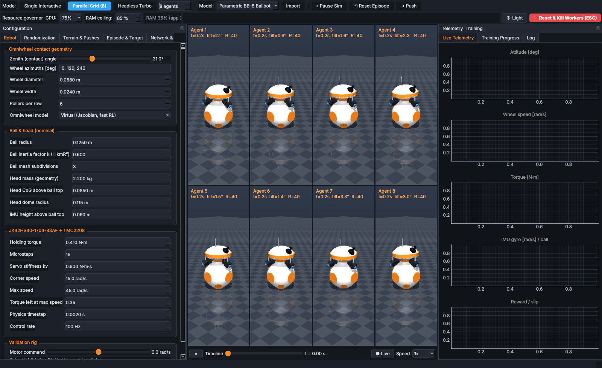

# BB-8 RL Suite & Deployment Studio

A 100 % local, native desktop application (PySide6 + MuJoCo + Gymnasium + Stable-Baselines3 + ONNX)
for **simulating, training, validating and exporting** reinforcement-learning balance policies for a
custom **head-balancing spherical robot** (a BB-8-style ballbot where *all* electronics and actuation
live in the head that balances on top of the ball), and **deploying** them on an **NVIDIA Jetson Nano**.

No web server, no browser, no TensorBoard: everything (3D viewport, plots, editors, exporters) is a
native Qt widget.



---

## Contents

1. [System architecture](#1-system-architecture)
2. [Installation & quick start](#2-installation--quick-start)
3. [Using the desktop app](#3-using-the-desktop-app)
4. [Physics model (what is simulated and how)](#4-physics-model)
5. [Domain randomisation, terrain & disturbances](#5-domain-randomisation-terrain--disturbances)
6. [Observation / action interface (sim ⇄ hardware contract)](#6-observation--action-interface)
7. [Training](#7-training)
8. [Export suite](#8-export-suite)
9. [Jetson Nano deployment guide](#9-jetson-nano-deployment-guide)
10. [Testing](#10-testing)
11. [Engineering compromises & known limitations](#11-engineering-compromises--known-limitations)

---

## 1. System architecture

```
                         ┌───────────────────────────── main_gui.py (PySide6 / Qt6) ─────────────────────────────┐
                         │ Toolbar: Mode [Single | Grid(8) | Headless] · Model [Rig | BB-8 | Import] · Theme ·    │
                         │          CPU-% governor · RAM ceiling · ⛔ Reset & Kill Workers (ESC)                  │
                         │ ┌ Config dock ─────────┐ ┌ Central ──────────────────────┐ ┌ Telemetry dock ────────┐ │
                         │ │ Robot geometry       │ │ MjViewport (MuJoCo GL → QImage)│ │ PyQtGraph live plots   │ │
                         │ │ Randomization (C/U/N)│ │  or GridViewer (≤8 agents)     │ │ Training curves        │ │
                         │ │ Terrain & pushes     │ │  or Headless placeholder       │ │ Log                    │ │
                         │ │ Episode & target     │ ├────────────────────────────────┤ └────────────────────────┘ │
                         │ │ Network & training   │ │ Timeline scrubber ⇄ plot cursor│                            │
                         │ │ Inspector + XML edit │ └────────────────────────────────┘                            │
                         │ └──────────────────────┘                                                               │
                         └──────┬────────────────────────────┬───────────────────────────────┬────────────────────┘
                                │ in-process (interactive)   │ mp.Queue / Events (spawn)     │ exports
                                ▼                            ▼                               ▼
 config_and_distributions.py   bb8_gym_env.py         rl_onnx_cpp_engine.py              .onnx  .cpp/.h  .csv  .zip
 ├ DistributionParameter        ├ BB8BalanceEnv        ├ training_worker_main  ──► SB3 PPO/SAC
 ├ AppConfig dataclasses        │  (stepper, IMU,      │   ├ SubprocVecEnv × N  ──► BB8BalanceEnv × N
 ├ OBS/ACTION channel spec      │   slip, pushes,      │   ├ GovernorCallback: pause/resume/stop, auto-save,
 ├ JSON + bundle ZIP            │   waypoints, falls)  │   │  best-model ONNX export, RAM ceiling, frames→grid
 └ Dark/Light stylesheets       └ ValidationRigSim     ├ PolicySnapshot (framework-neutral actor)
                                         ▲             ├ cold-start initial_policy.onnx (tanh, ortho/Xavier)
 mjcf_generator.py ──────────────────────┘             ├ hand-built ONNX graph + onnxruntime verification
 ├ parametric BB-8 MJCF (zenith 31°→40°+)              └ zero-dependency C++ generator
 ├ validation rig MJCF
 ├ dented/non-spherical ball mesh            deployment_jetson/
 ├ terrain layers (tiles, hfield, walls,     ├ arduino_nano33iot_imu_i2c/*.ino   (LSM6DS3 + Mahony, I2C slave 0x42)
 │  ramps, bumps, stairs, obstacle arena)    ├ jetson_control_loop.py            (ONNX Runtime / C++ .so / SIL)
 └ MJCF/URDF/STL/OBJ importer + binder       ├ jetson_control_loop.cpp           (SCHED_FIFO, UART VACTUAL or STEP/DIR)
                                             ├ CMakeLists.txt · robot_hw_config.json
```

| File | Responsibility |
|---|---|
| `config_and_distributions.py` | `DistributionParameter` (Constant / Uniform / Normal + clamping), every config dataclass, observation/action channel spec (single source of truth for ordering, units, normalisation), JSON & experiment-ZIP serialisation, Dark/Light themes |
| `mjcf_generator.py` | Procedural MJCF: BB-8 ballbot, validation rig, dented sphere mesh, terrain, importer, omniwheel geometry/Jacobian |
| `bb8_gym_env.py` | Gymnasium env with full domain randomisation, stepper/TMC2208 model, IMU noise+drift, pushes, falls, waypoints; `ValidationRigSim` |
| `rl_onnx_cpp_engine.py` | Cold-start ONNX, ONNX/C++ exporters, SB3 bridge, training worker process, process-tree governor |
| `main_gui.py` | The desktop application |
| `deployment_jetson/` | Arduino firmware, Jetson Python & C++ runners, CMake, hardware config |
| `tests/` | Headless smoke tests + scripted end-to-end GUI exercise |

---

## 2. Installation & quick start

```bash
python3 -m venv .venv
```

```bash
source .venv/bin/activate
```

```bash
pip install -r requirements.txt
```

```bash
python main_gui.py
```

Useful flags: `--mode grid|single|headless`, `--workspace PATH`, `--config my_config.json`.

On first start the app creates `./workspace/` and — because no `.onnx` exists yet — writes
`workspace/initial_policy.onnx` (+ `.json`), a tanh network with orthogonal (or Xavier) weights.
Training is initialised **from these exact weights**, so every run starts from a valid, inspectable ONNX file.

> **Linux without a display / remote CI:** `MUJOCO_GL=egl` (GPU) or `MUJOCO_GL=osmesa` (CPU) with
> `QT_QPA_PLATFORM=offscreen`. On normal desktops nothing needs to be set.

---

## 3. Using the desktop app

### Execution modes (toolbar)
| Mode | What happens |
|---|---|
| **Single Interactive** | One environment rendered at up to 60 FPS. Left-drag rotate, right-drag pan, wheel/middle zoom, **double-click** selects a part (emissive magenta highlight + inspector), **Ctrl+click / Ctrl+drag** moves the live waypoint target. Space = pause/run. |
| **Parallel Grid (1–8)** | Up to 8 viewports. While training they show the *actual training environments* streamed from the worker (~25 Hz, including each env's randomised geometry); otherwise 8 local evaluation envs driven by the selected policy. |
| **Headless Turbo** | OpenGL rendering fully off in the GUI *and* the worker stops streaming frames — physics/training run as fast as the CPU allows. Plots/logs keep updating. |

### Hardware resource governor
* **CPU %** (25/50/75/100) → number of cores the training process tree is pinned to (`psutil.cpu_affinity`, inherited by every SubprocVecEnv worker) and `torch.set_num_threads`.
* **RAM ceiling %** → monitored with `psutil` in both GUI and worker; exceeding it triggers an immediate checkpoint (and optionally pauses training: `resources.pause_on_ram_ceiling`).

### ⛔ ESC / "Reset & Kill Workers"
Immediately stops the simulation timer, **kills the whole training process tree** (psutil, children first), flushes and closes the IPC queues, releases every GL renderer, then asks whether to restore *all* parameters to factory defaults.

### Model switcher
1. **Validation Rig** – one JK42HS40 + 58 mm multi-roller omniwheel spring-preloaded (default preload = head weight / 3 / cos θ) against a bearing-mounted test sphere. Use the *Motor command* slider (Robot tab) and watch encoder speed, torque vs. the speed-dependent torque limit, measured vs. predicted sphere speed and slip ratio.
2. **Parametric BB-8** – the main procedurally generated robot. Dragging the **zenith slider** (15°–60°) rebuilds wheel positions, axles, contact normals, motor mounts and the Jacobian instantly.
3. **Custom Import** – `.xml` (MJCF), `.urdf` (converted by MuJoCo, `package://` paths resolved), `.stl`/`.obj` (ASCII STL auto-converted; as a **visual head shell on the parametric robot** or a free body; mm or m units). In the *Inspector* tab bind **IMU body, ball body and up to 3 wheel joints**: an `imu` site + gyro/accelerometer/framequat sensors and `motor1..3` velocity actuators are injected, and the standard observation vector is built so any exported policy can drive it. Imported MJCF that contains the BB-8 names (e.g. a model exported by this app) runs with the full RL environment.

### Inspector & XML editor
Select in the tree or double-click in 3D → the part glows magenta (scene-level `emission`), its live
properties (body: mass / pos / ipos / inertia; geom: friction / size / pos / rgba) can be edited and are
**re-applied after every domain-randomisation reset**. The XML pane shows the selected element's MJCF;
*Apply XML & Recompile* splices it into the model and recompiles on the fly (*Edit full model XML* for
arbitrary edits, *Revert to procedural* to go back).

### Timeline scrubber
Every interactive step records `qpos`, mocap and ~30 telemetry channels (IMU, encoder & command per
wheel, torques, reward, positions, slip, pushes, missed steps). Pause (or grab the slider) and drag: the 3D
view is restored to that instant (`mj_kinematics`) and a magenta cursor moves on all plots. *● Live*
restores the exact live state and continues.

---

## 4. Physics model

### Geometry (head frame, origin at ball centre)
For wheel *i* with azimuth α<sub>i</sub> ∈ {0°,120°,240°} and zenith θ (31° now, 40° target):

* contact normal  n<sub>i</sub> = (sinθ cosα, sinθ sinα, cosθ),  contact point  p<sub>i</sub> = R n<sub>i</sub>
* drive direction t<sub>i</sub> = (−sinα, cosα, 0),  wheel axle  m<sub>i</sub> = n<sub>i</sub> × t<sub>i</sub> = (−cosθ cosα, −cosθ sinα, sinθ)
* wheel centre c<sub>i</sub> = (R + r<sub>i</sub>) n<sub>i</sub>
* no-slip transmission: **φ̇<sub>i</sub> = (R / r<sub>i</sub>) m<sub>i</sub> · ω<sub>rel</sub>**, ω<sub>rel</sub> = head-relative-to-ball angular velocity (head frame).
  `omniwheel_jacobian()` returns this 3×3 matrix J; the Jetson odometry uses J⁻¹.

### Two omniwheel fidelity levels (Robot tab → *Omniwheel model*)
| | **Virtual (default, RL)** | **Multi-roller contact** |
|---|---|---|
| Head–ball coupling | 3-DoF ball joint at ball centre | free head resting on the ball |
| Wheel | ideal transmission: MuJoCo `velocity` actuator **on the ball joint with 3-D gear (R/r<sub>i</sub>)·m<sub>i</sub>** – exactly the Jacobian above, integrated implicitly (`implicitfast`) | hinge hub + 2 staggered rows of passive rollers (hinge about rim tangent), sphere geoms in real frictional contact with the ball |
| Lateral roller friction | damping along roller directions on the ball-joint DoFs | roller hinge damping |
| Longitudinal grip / slip | traction limit μ<sub>i</sub>·N·r<sub>i</sub> on actuator force, slip flag, slipping encoder spins to command | contact friction |
| Rotor inertia | reflected `dof_armature` = J<sub>rotor</sub>·diag(JᵀJ) | hinge `armature` |
| Speed (1 core, 100 Hz control, 500 Hz physics) | ~2.7–3.5 k control steps/s | ~2× slower |

Stock MuJoCo cannot orient anisotropic (orthotropic) friction in the contact frame, so the virtual model
reproduces omniwheel kinematics exactly and the roller model reproduces them through contacts. The
validation rig measures the roller model's transmission ratio within ≈5 % of R/r (roller envelope ripple).

### Stepper + TMC2208 model
* Velocity servo (stiff "stepper-like" `kv`) with **pull-out torque curve**: 0.41 N·m holding × supply-voltage
  scale, flat to the corner speed (15 rad/s), linearly down to 35 % at max speed (45 rad/s).
* **Micro-step quantisation** of the commanded rate per control tick, **deadband**, **command latency**.
* **Missed steps**: whenever the servo saturates on the stepper limit, the lost micro-steps are accumulated
  (`info["missed_steps"]`) — the encoders then disagree with open-loop step counting, as on hardware.
* Traction note: at θ = 31° with a 2.2 kg head the normal load per wheel is N = m g / (3 cos θ) ≈ 8.4 N, so
  with μ ≈ 0.9 the **transmissible torque is ≈ 0.22 N·m — about half the 0.41 N·m holding torque**.
  At 40°, N ≈ 9.4 N (+12 %). Grip, not motor torque, is usually the limiting factor.

### Sensors
* **IMU (Arduino Nano 33 IoT, LSM6DS3, no magnetometer)**: ZYX roll/pitch/yaw from the IMU site quaternion,
  gyro and accelerometer (specific force, +9.81 on z when level) in the head frame; white noise + bias
  random walk on every channel; yaw has its own (larger) drift because it is gyro-integrated.
* **Magnetic encoders**: absolute single-turn position (wrapped ±π) and velocity with noise.

### Ball imperfections
High-tessellation icosphere (`ball_mesh_subdivisions`, 642 vertices at level 3) with random ellipsoidal
stretch (non-sphericity) and Gaussian dents/bumps. MuJoCo collides meshes via their **convex hull**:
outward bumps act fully, inward dents become *flat spots* bridging the dent — which is precisely how a hard
dented shell rolls on flat ground. CoM offset is applied to the ball inertial frame.

### Fall / contact-loss detection
Tilt > threshold, **or** (virtual model) the ball-joint reaction force would have to *pull the head down*
(`cfrc_int` along head z < 0 for > 80 ms ⇒ the real head would lift off), **or** (roller model) no
roller–ball contact for > 80 ms.

---

## 5. Domain randomisation, terrain & disturbances

Every parameter below is a `DistributionParameter` editable in the GUI as **Constant**, **Uniform(min,max)**
or **Normal(μ,σ)** (with safety clamps) and is **re-sampled on every reset** — manual or automatic after a fall.

| Group | Parameters |
|---|---|
| Ball | mass, sliding grip, torsional friction, rolling resistance, non-sphericity, dent depth (+count), CoM offset |
| Omniwheels | longitudinal grip, lateral roller resistance, rolling resistance, **per-wheel diameter offset** and **per-wheel grip offset** (asymmetric wear) |
| Head | total mass, CoG offset dx/dy/dz |
| Actuators | supply-voltage torque scale, deadband, latency (control ticks), servo stiffness |
| IMU/encoders | orientation noise & drift, yaw drift, gyro noise & bias walk, accel noise & bias walk, encoder velocity noise |
| Terrain | ground grip factor (per tile when *Variable grip* is on) |
| Pushes | interval [s], magnitude [N], azimuth & elevation [deg], duration [s] — applied with `xfrc_applied` to head or ball |
| Episode | initial tilt, initial yaw, training target X/Y |

Parameters that change geometry (dents, non-sphericity, wheel diameters in roller mode) trigger an automatic
MJCF regeneration + recompile at reset (~0.1–0.2 s); everything else is patched in place (`mj_setConst`).
Ground friction is implemented with geom **priority** so that *ball surface × local ground grip* is what the
contact actually uses.

**Map selector**: *Standard Flat Ground* or *Obstacle Arena* (walls + seeded boxes/cylinders).
**Layer checkboxes**: `Off (Ideal Nominal Physics)` collapses every distribution to its nominal value,
`Variable Ground Texture / Grip` (N×N friction tiles), `Procedural Rough Ground (Heightfield)` (multi-octave
noise re-generated every reset, flat spawn pad), `Walls / Arena Boundaries`, `Minor Ramps & Slopes`
(ridges of configurable slope), `Speed Bumps & Stairs`.

**Episode control**: auto-reset on fall, tilt threshold, contact-loss detection, spawn at exact centre (0, 0)
(to diagnose directional rolling bias), live waypoint `(X, Y)` changeable mid-episode via spinboxes or
Ctrl+click — also forwarded to all training environments while training.

---

## 6. Observation / action interface

This ordering is the contract between simulator, ONNX file, C++ export and Jetson runners
(`config_and_distributions.OBS_GROUPS`). Any group can be masked off in the GUI.

| # | Channel (C++ argument name) | Unit | Normalisation × |
|---|---|---|---|
| 0–2 | `imu_roll_rad`, `imu_pitch_rad`, `imu_yaw_rad` | rad | 1/0.3, 1/0.3, 1/π |
| 3–5 | `imu_gx_rads`, `imu_gy_rads`, `imu_gz_rads` | rad/s (head frame) | 1/2 |
| 6–8 | `imu_ax_ms2`, `imu_ay_ms2`, `imu_az_ms2` | m/s² (specific force) | 1/9.81 |
| 9–11 | `enc1_vel_rads` … `enc3_vel_rads` | rad/s | 1/20 |
| 12–14 | `enc1_pos_rad` … `enc3_pos_rad` (off by default) | rad, wrapped ±π | 1/π |
| 15–16 | `target_dx_m`, `target_dy_m` | m, heading (IMU-yaw) frame, clipped to 2 m | 1 |
| 17–19 | `prev_motor1_cmd` … `prev_motor3_cmd` | normalised [−1, 1] | 1 |

**Actions** (each maskable): 3 × normalised command in [−1, 1] →
*velocity mode* (default, matches step/dir or VACTUAL hardware): × `stepper_max_speed_rads` (45 rad/s) →
× steps/rad (200·µsteps/2π) = step rate; *torque mode*: × 0.41 N·m.

Frames: head x = forward (the "eye"), z = up. Wheel speed positive = right-handed about axle m<sub>i</sub>.

---

## 7. Training

*Network & Training* tab → hidden layers (e.g. `64, 64` or `128, 128, 64`), init, observation/action masks,
algorithm (PPO default, SAC), parallel envs, vectorisation, timesteps, LR, rollout, batch, γ,
**auto-save every N steps / M minutes**, seed. Buttons: **Start, Pause** (checkpoint on pause),
**Resume, Stop** (final checkpoint), **Save Session, Load Session** (Start then resumes from the
session's `latest_model.zip`).

The worker runs in a separate *spawned* process (GUI stays responsive; ESC can kill it instantly).
Outputs in `workspace/`:

```
workspace/
├ initial_policy.onnx/.json        cold start
├ best_policy.onnx/.json           best rolling-mean return so far (auto-exported, rate-limited)
├ checkpoints/ckpt_<tag>_<steps>.zip   auto / pause / manual / ram_ceiling / final
└ sessions/session_<stamp>/        config.json, latest_model.zip, best_model.zip, training_progress.csv
```

`training_progress.csv` logs per episode: timesteps, wall time, return, **survival time**, mean/max
**tilt**, final **waypoint distance**, fall flag, missed steps.

Reward (weights editable live): alive + upright (1 − (tilt/limit)²) − angular velocity − action − action
rate − ball velocity² − drift from spawn; with a target: − distance + progress + reach bonus; − fall penalty.

Tips: start with *Off (Ideal Nominal Physics)* to get a first balancing policy, then enable randomisation
layers; use Headless Turbo for long runs; 8 envs on 4–8 cores is a good default.

---

## 8. Export suite

| Button | Output |
|---|---|
| **Export Best .onnx** | copy of `best_policy.onnx` (asks the worker to snapshot the current policy first). Inputs `obs_raw [batch, n]` in **physical units** (normalisation & clipping are inside the graph); outputs `action [batch, 3]` ∈ [−1, 1] and `motor_cmd_rads` (or `motor_cmd_torque_nm`). Metadata: `obs_names`, `obs_scale`, `action_names`, `action_mode`, `layer_sizes`… Opset 17 / IR 8 for older JetPack ONNX Runtime builds. |
| **Export C++ Policy (.cpp/.h)** | `bb8_policy_inference.cpp/.h`: C++11 + `<cmath>` only, weights as `static const float`, no heap. API: `bb8::compute_stepper_commands(float imu_roll_rad, float imu_pitch_rad, …, float enc1_vel_rads, …, float target_dx_m, …, float* out_motor1_step_rate, …, float* out_motor1_rads = nullptr, …)` plus `bb8::policy_forward()` and `extern "C" bb8_policy_forward_c()` (for ctypes). |
| **Export Telemetry (.csv)** | timeline buffer (all channels) + training curves (+ the session's `training_progress.csv`). |
| **Export Complete Experiment Bundle (.zip)** | `bb8_experiment_<timestamp>.zip`: policy (.onnx + .json), C++ (.cpp/.h), telemetry CSVs, the exact MuJoCo `.xml`, `config_snapshot.json` (every randomisation & hyper-parameter), manifest. |

The ONNX graph and the C++ code are verified against the numpy reference forward pass in the tests
(max error < 1e-5).

---

## 9. Jetson Nano deployment guide

### 9.1 Hardware architecture

```
                 ┌──────────────────────────── HEAD ────────────────────────────┐
                 │                                                              │
 ┌───────────────┴──────┐  I2C slave 0x42 (2nd bus SERCOM1: D11=SDA, D13=SCL)   │
 │ Arduino Nano 33 IoT  │◄──────────────┐                                       │
 │ LSM6DS3 6-DoF IMU    │               │  /dev/i2c-1 (pins 3 SDA, 5 SCL, 3.3 V) │
 │ Mahony AHRS @416 Hz  │               │                                       │
 └──────────────────────┘     ┌─────────┴──────────┐   I2C 0x70   ┌──────────┐  │
                              │   NVIDIA Jetson    ├─────────────►│ TCA9548A │  │
                              │       Nano         │              │ I2C mux  │  │
                              │ policy @100 Hz     │              └┬───┬───┬─┘  │
                              │ (ONNX RT / C++)    │      ch0 ch1 ch2 (0x36 each)
                              └──┬───────────┬─────┘               ▼   ▼   ▼     │
                       USB/UART  │           │ GPIO (alt.)     AS5600 ×3 magnetic│
                     (VACTUAL)   ▼           ▼ STEP/DIR/EN     encoders on the   │
                 ┌──────────┬──────────┬──────────┐            rear motor shafts │
                 │ TMC2208 1│ TMC2208 2│ TMC2208 3│  VM 12–24 V (3S/4S LiPo)      │
                 └────┬─────┴────┬─────┴────┬─────┘                              │
                      ▼          ▼          ▼                                    │
               JK42HS40-1704 ×3 (0.41 N·m, 1.7 A) + 58 mm omniwheels @ 0/120/240°│
                 └──────────────────────────────┬───────────────────────────────┘
                                                ▼  zenith contact angle 31° → 40°
                                         hand-coated epoxy/sawdust ball
```

### 9.2 Wiring tables

**Arduino Nano 33 IoT ↔ Jetson** (3.3 V logic on both sides — the Nano 33 IoT is *not* 5 V tolerant)

| Nano 33 IoT | Jetson 40-pin header | Note |
|---|---|---|
| D11 (SDA, SERCOM1 PAD0) | pin 3 (I2C1_SDA, `/dev/i2c-1`) | carrier has 2.2 kΩ pull-ups |
| D13 (SCL, SERCOM1 PAD1) | pin 5 (I2C1_SCL) | |
| GND | pin 6 | common ground |
| VIN | pin 2 or 4 (5 V) | or USB from the Jetson |

The LSM6DS3 sits on the Nano's *main* I2C bus where the SAMD21 must be master, so the Jetson link uses the
second hardware I2C (SERCOM1) on D11/D13 where the SAMD21 is a slave.

**AS5600 encoders** (all address 0x36 → TCA9548A mux at 0x70 on the same Jetson bus)

| TCA9548A | Connects to |
|---|---|
| SDA/SCL | Jetson pins 3/5, VIN 3.3 V (pin 1), GND |
| SD0/SC0 | AS5600 #1 (motor 1, azimuth 0°) |
| SD1/SC1 | AS5600 #2 (motor 2, 120°) |
| SD2/SC2 | AS5600 #3 (motor 3, 240°) |

AS5600: VCC 3.3 V, DIR → GND, diametric 6 × 2.5 mm magnet glued centred on the rear shaft, 0.5–3 mm gap.

**TMC2208 (recommended: UART VACTUAL velocity mode)** — the driver's internal step generator makes the
pulses, so Linux scheduling jitter cannot cause missed steps. TMC2208 has a fixed UART address, so each driver
gets its own UART: e.g. an FT4232H quad USB-UART (`/dev/ttyUSB0..2`) or three CP2102 adapters.

| TMC2208 pin | Connection |
|---|---|
| VM / GND | motor supply 12–24 V, 100 µF low-ESR cap at each driver |
| VIO | 3.3 V |
| EN | GND (always enabled) — or a Jetson GPIO for a hardware kill |
| MS1 / MS2 | GND (ignored once UART sets MRES) |
| PDN_UART | USB-UART **RX** directly, **TX through 1 kΩ** (single-wire half duplex). Some StepStick boards need the PDN/UART solder bridge closed. |
| A1 A2 B1 B2 | motor coils |

Run-current: `tmc_irun` (default 20/31 ≈ 1.15 A RMS with 0.11 Ω sense resistors), hold `tmc_ihold`;
spreadCycle is enabled for torque at speed.

**Alternative STEP/DIR mode** (`-DUSE_STEP_DIR=ON`, libgpiod, 20 kHz SCHED_FIFO DDS thread, max 10 k µsteps/s per
motor → 8 µsteps gives ≈39 rad/s, use 4 µsteps for the full 45 rad/s):

| Signal | Motor 1 | Motor 2 | Motor 3 |
|---|---|---|---|
| STEP | pin 29 (gpio149) | pin 33 (gpio38) | pin 37 (gpio12) |
| DIR | pin 31 (gpio200) | pin 35 (gpio76) | pin 38 (gpio77) |
| EN (shared, active low) | pin 40 (gpio78) | | |

(Line numbers are `gpiochip0` offsets on JetPack 4.x; verify with `gpioinfo`. Set them in `robot_hw_config.json`.)

**Power**: Jetson from a dedicated 5 V/4 A barrel supply (jumper J48) or a 5 V/5 A BEC; motors from the LiPo;
*all grounds common*. Add an inline fuse and a physical kill switch on VM.

### 9.3 Flash the Arduino

1. Arduino IDE → Boards Manager → *Arduino SAMD Boards* → board **Nano 33 IoT**.
2. Library Manager → **Arduino_LSM6DS3**.
3. Open `deployment_jetson/arduino_nano33iot_imu_i2c/arduino_nano33iot_imu_i2c.ino`; adjust `kAxisMap`/`kAxisSign`
   so that the head frame is **x forward (eye), y left, z up**; upload.
4. Serial monitor (115200) prints roll/pitch/yaw in degrees; the LED is on during gyro calibration.

The 24-byte I2C packet, commands (0x01 re-calibrate, 0x02 zero yaw, 0x03 Mahony gains) and scaling are
documented at the top of the sketch.

### 9.4 Prepare the Jetson Nano (JetPack 4.6.x)

```bash
sudo apt-get update
```

```bash
sudo apt-get install -y python3-pip i2c-tools cmake g++ libgpiod-dev
```

```bash
sudo usermod -aG i2c,dialout,gpio $USER
```

```bash
pip3 install numpy smbus2 pyserial onnx
```

Install ONNX Runtime for JetPack (GPU build from the NVIDIA Jetson Zoo matching your JetPack/Python; the
CPU-only `onnxruntime` wheel also works — a 64×64 MLP runs far below 1 ms on the Cortex-A57).

Check the bus — you should see `0x42` (Arduino) and `0x70` (mux):

```bash
i2cdetect -y -r 1
```

Copy to the Jetson: the `deployment_jetson/` folder, the exported `best_policy.onnx` and/or `bb8_policy_inference.cpp/.h`
(both are inside the experiment bundle). Edit `robot_hw_config.json`: **geometry must match the simulation the
policy was trained with** (ball radius, wheel radius, zenith angle, azimuths, max wheel speed, microsteps).

### 9.5 Python runner (ONNX Runtime)

```bash
cd deployment_jetson
```

```bash
python3 jetson_control_loop.py --dry-run --policy best_policy.onnx
```

```bash
sudo chrt -f 80 python3 jetson_control_loop.py --policy best_policy.onnx
```

`--target X Y` enables waypoint driving (odometry from encoders + gyro via J⁻¹), `--cpp-lib build/libbb8_policy.so
--policy-meta best_policy.json` uses the exported C++ through ctypes instead of ONNX Runtime. Every cycle is
logged to `jetson_run_log.csv` (same channel names as the simulator telemetry → compare sim vs. real in any
plotting tool).

### 9.6 C++ runner (hard real-time)

```bash
cd deployment_jetson && mkdir -p build && cd build
```

```bash
cmake .. -DPOLICY_DIR=/home/jetson/bb8_export/cpp
```

```bash
make -j4
```

```bash
sudo ./bb8_jetson_runner ../robot_hw_config.json
```

Variants: `-DUSE_ONNXRUNTIME=ON -DONNXRUNTIME_ROOT=/usr/local` (runs `policy_onnx` from the config instead of the
compiled weights), `-DUSE_STEP_DIR=ON` (GPIO pulses via libgpiod). The runner uses `mlockall`, `SCHED_FIFO` and
absolute-time `clock_nanosleep`, reports loop time and overruns, and also builds `libbb8_policy.so` for Python.

### 9.7 Software-in-the-loop check (on the PC, before touching hardware)

```bash
python3 deployment_jetson/jetson_control_loop.py --sil --policy workspace/best_policy.onnx --seconds 20
```

`--sil` replaces the hardware drivers with the MuJoCo environment but keeps **everything else identical**
(absolute encoder wrapping + differentiation + low-pass, odometry, target transform, observation assembly,
policy call, command scaling), printing odometry next to ground truth. Add `--sim-config config_snapshot.json`
from a bundle to reproduce the exact trained configuration.

### 9.8 Bring-up checklist

1. Robot on a stand, ball removed. `--dry-run`: tilt the head forward → `imu_pitch_rad` must become **positive**
   (nose-down = +pitch about +y); roll right → `imu_roll_rad` positive; rotate CCW (from above) → `imu_gz_rads` positive.
2. Spin each wheel by hand in its positive direction (right-handed about the axle that points inward/up) →
   `encN_vel_rads` positive; otherwise flip `encoder_direction_sign`.
3. Command a small positive speed per motor (e.g. temporarily via the Python REPL with `TMC2208UART.set_velocity`)
   → encoder must read positive; otherwise flip `motor_direction_sign`.
4. Verify the zenith angle you built matches `zenith_angle_deg` (the policy is geometry-specific — retrain
   when moving from 31° to 40°).
5. First balance attempts with a tether and the `tilt_cutoff_deg` safety stop (default 35°); keep a hand on the VM kill switch.

---

## 10. Testing

```bash
python tests/test_smoke.py
```

Covers: distribution sampling & config round-trip; both omniwheel models with heightfield, dents, pushes and
targets; the validation rig transmission ratio; cold-start ONNX → onnxruntime → reload → generated C++
compiled with `g++ -Wall -Werror` and compared numerically; experiment ZIP; a short PPO run through the
real multiprocess `TrainingController` (episodes, frames, checkpoints, best-model ONNX).

```bash
QT_QPA_PLATFORM=offscreen MUJOCO_GL=osmesa python tests/test_gui_offscreen.py
```

Drives the full GUI headlessly: target picking, part selection + live property override, XML splice and
recompile, zenith slider rebuild, pause/scrub/live, validation rig, theme toggle, 4-agent grid, training
streamed into the grid, all four exporters, policy loading, MJCF/STL/URDF import + RL binding, headless
mode and ESC factory reset.

---

## 11. Engineering compromises & known limitations

* **Viewport rendering**: MuJoCo renders with its own OpenGL context off-screen and the frame is blitted
  into a native Qt widget. This avoids QOpenGLWidget FBO/context-sharing pitfalls across Windows/Linux/macOS
  at the cost of one GPU→CPU read-back per frame (≈1–3 ms at 1080p on a desktop GPU).
* **Parallel grid** is a multi-viewport grid (one small renderer per agent) rather than an 8-arena single
  scene, so each agent keeps its own randomised geometry.
* **Omniwheels**: stock MuJoCo cannot orient anisotropic contact friction, hence the Jacobian ("virtual")
  model for RL and the multi-roller model for fidelity checks. The roller model shows a ±5 % transmission ripple.
* **Dents** act through the convex hull (flat spots), not as concave pockets.
* **Odometry** (target observation on hardware) assumes no slip; while wheels slip it over-estimates
  distance — retrain with targets disabled for pure balancing if you do not need waypoints.
* **Training status (measured, not yet solved)**: with the default randomisation on a 4-core CPU
  (~1.4 k steps/s), PPO goes from ~0.6 s to ~7–8 s mean survival (episode limit 20 s) within 0.5–1.2 M steps
  and then plateaus. The dominant failure mode is a slow drift that builds up until the wheels saturate at
  `stepper_max_speed_rads` (~1.7 m/s ball speed), after which the head falls. Expect to need longer runs
  (several million steps, Headless Turbo, all cores) and reward/curriculum tuning (e.g. start with
  *Off (Ideal Nominal Physics)*, raise `ball_velocity`/`drift` weights) to get a policy fit for hardware.
  A hand-tuned PD velocity controller balances the same model indefinitely, so the plant is controllable.
* Policies are geometry-specific: retrain (or fine-tune from the session) after changing zenith angle,
  wheel size or ball radius.
